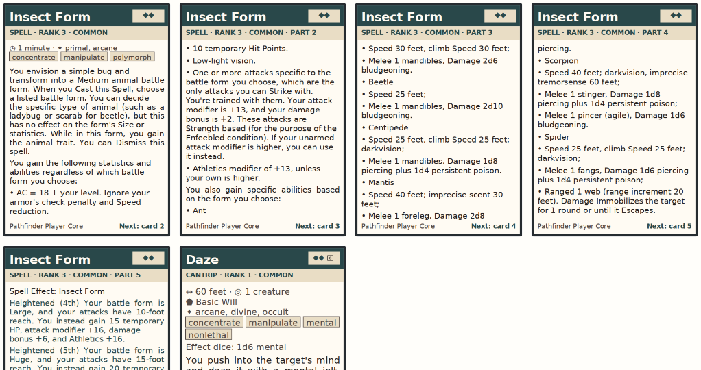

# Printable Spells

Create printable Pathfinder 2e spell cards.

## Preview



Heal fits on two faces of one card. These are the two pages from its A4 duplex export.

| Front | Back |
| --- | --- |
|  |  |

The back page mirrors the card placement left to right. When you flip the physical sheet along its long edge, the two faces and their cut guides line up. Print on A4 at **Actual size (100%)** with **Flip on long edge**, then cut along the guides.

## Use Spell Cards

1. Search for spells and select the ones you want. Use **Import Pathbuilder JSON** to paste a character export and select known, prepared, and focus spells and rituals by name. The browser sends spell names to the catalog and reports names it cannot match.
2. Check the responsive preview grid. Each tile shows a playing-card page from the PDF renderer. **Double-sided** is enabled by default. Select a card to flip between its front and back, or uncheck **Double-sided** to preview and export single-sided cards. Long spells have numbered continuation cards that appear in order.
3. Choose **Playing-card pages** or **A4 cut sheets** and click **Generate PDF**. The layout choice applies to the export. When it is ready, click **Download PDF**.
4. Print at **Actual size** or **100%**. Both layouts use 63.5 × 88.9 mm cards. A4 sheets fit up to nine cards and include cut guides. Double-sided exports pair continuation cards with their fronts. Print double-sided with **Flip on long edge**. Cards without a continuation get a matching back.

The cast box shows action symbols and the dice the caster rolls. ◆ marks one action, ◇ marks a free action, and ↶ marks a reaction. Longer casting times are written out. Heightened effects follow the base rules.

## Local development

From the Printable Spells checkout, use JDK 25 and Maven to fetch the pinned spell catalog, generate the API clients, and verify the application.

```bash
mvn -B -Pfetch-foundry-pf2e-spells verify
```

Maven manages Node by default. Add `system-node` to the profile list to use Node.js 24 and npm from your PATH.

### IntelliJ with the shared dev workspace

The separate `dev-workspace` repository provides RabbitMQ and generated IntelliJ configurations. From its root, run:

```bash
./bin/init-workspace
./bin/services-up rabbitmq
```

Open the workspace root in IntelliJ and import its Maven project. Start `spellcards-app`, `spellcards-worker`, and `spellcards-web-dev`, or use the `fullstack-dev` compound configuration. Open the URL printed by Vite, normally `http://localhost:5173`. Vite proxies API requests to port 8080.

When running the API and worker outside these configurations, give both processes the same RabbitMQ credentials and the same absolute `SPELLCARDS_ARTIFACT_DIR` path.

### Local Docker Compose

The base Compose file runs the API, worker, and web app and shares the PDF artifact volume. The checked-in overlays publish the web port. The production overlay publishes port 80 and the staging overlay publishes port 8081 for local use.

For a checkout at `dev-workspace/workspace/printable-spells`, first initialize the workspace and start RabbitMQ as above. Then run these commands from the Printable Spells checkout:

```bash
docker compose --env-file ../../.env -f docker-compose.yml -f docker-compose.prod.yml up --build -d
```

Open `http://localhost`. To stop the stack:

```bash
docker compose --env-file ../../.env -f docker-compose.yml -f docker-compose.prod.yml down
```

Compose expects RabbitMQ at `host.docker.internal:5672`. If your Docker host cannot route containers to the workspace broker's loopback binding, use the IntelliJ setup above or provide a broker reachable by the containers. For a standalone checkout, supply your own env file with `RABBITMQ_USERNAME` and `RABBITMQ_PASSWORD`.

## Data and PDF rendering

- [spellcards-api](spellcards-api) defines the OpenAPI contract and generates the server API types.
- [spellcards-app](spellcards-app) searches the catalog at `GET /api/v1/spells/search` and resolves imported spell names at `POST /api/v1/spells/resolve`. The Foundry release is pinned in [its POM](spellcards-app/pom.xml). The fetch profile reads `packs/spells.json` from `json-assets.zip` and caches it under `spellcards-app/src/generated/resources/foundry/`. Matching cached data is reused. Run Maven `clean verify` with the fetch profile to refresh it.
- [spellcards-queue](spellcards-queue) defines the RabbitMQ job messages. The API records a manifest before publishing to the queue, which defaults to `spellcards.pdf.jobs`.
- [spellcards-worker](spellcards-worker) renders both PDF layouts. The API and worker share the artifact directory, and completed PDFs are retained for 24 hours by default. Submit a job at `POST /api/v1/spellcards/jobs`, read its status at `GET /api/v1/spellcards/jobs/{jobId}`, and fetch the completed PDF from its returned download URL.
- [spellcards-web](spellcards-web) requests playing-card PDFs for the preview and renders the pages in the browser. Print exports use the same worker and start on demand.

## Deployment

The [Deploy workflow](.github/workflows/deploy.yml) publishes commit-tagged API, worker, and web images to GHCR on pushes to `main`. It dispatches staging to `homelab-ops` and waits for that run to pass, including the homepage and spell search checks. The workflow then hands off the same image tag to its production job. GitHub's configured `production` environment rules apply to that job, including the required reviewer currently configured.

Spell Cards uses this repository's workflow to coordinate its deploys. Other homelab services are deployed separately from `homelab-ops`.

To promote an existing image or roll back, manually run **Deploy** with its `sha-…` image tag in `rollback_tag`. Choose **both** to verify staging before production, **staging** to validate only, or **production** to dispatch directly under the production environment rules. The dispatch token `HOMELAB_OPS_DISPATCH_TOKEN` needs **Contents: Read and write** to dispatch and **Actions: Read-only** to check staging runs in `Viturin/homelab-ops`.
